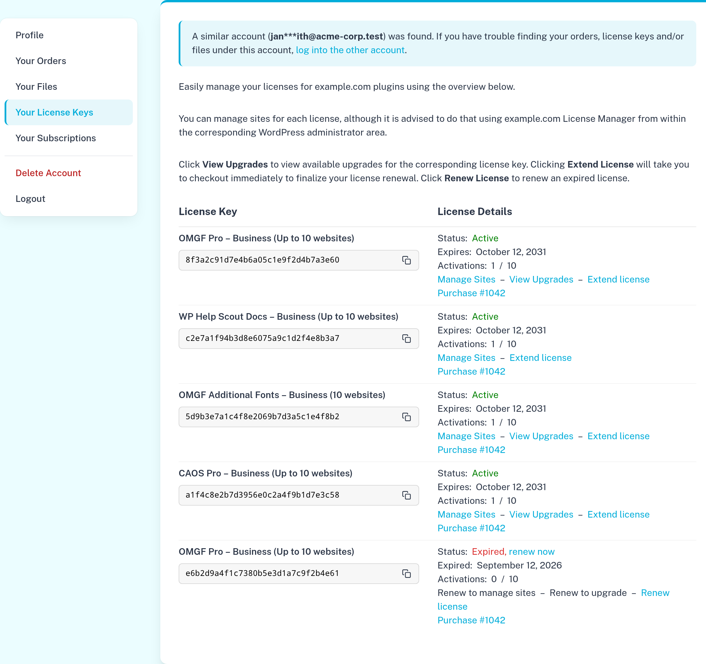
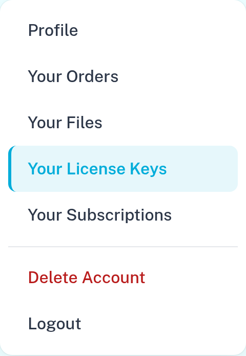
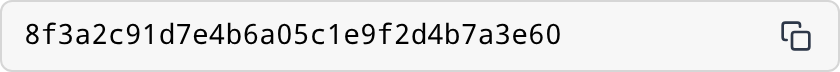
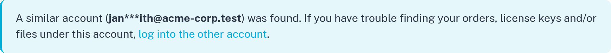

## Better Account for Easy Digital Downloads

Adds tabs to your account pages (Profile, Orders, License Keys, Subscriptions, etc.), so customers can easily switch
between them. You manage the tabs as a regular WordPress menu.



### How to use

1. Go to **Appearance > Menus** and create a menu with your account pages, e.g. Account (your profile), Orders, Files,
   License Keys, Subscriptions, and a **Custom Link** to `/wp-login.php?action=logout` for logging out.
2. Assign the menu to the **Account Tabs** location.

That's it. Logged-in customers now see the tabs on:

- every page in the menu, including the views on that page (e.g. **Manage Sites** on License Keys, or **View
  Transactions** and **Update Payment Method** on Subscriptions),
- subpages of a page in the menu (they belong to the tab of their parent),
- EDD Recurring's **Update Payment Method** page (`/subscription/update/…`), with the tab of the page that holds the
  `[edd_subscriptions]` shortcode or Subscriptions block marked as current.

Only top level menu items are shown. Logged out visitors don't see the tabs.



Logged out visitors who open an account page (e.g. Orders or License Keys, which show nothing to them) are sent to the
login page: EDD's **Login Page** (Settings > General > Pages), or else the first tab (e.g. your profile page, which
shows a login form to logged out visitors). After logging in, they're sent back to the page they opened. The Delete
Account page still shows that an account was deleted.

On smaller screens, the current tab becomes a button that opens the other tabs.

License key fields (EDD Software Licensing) get a button to copy the license key.



Customers who also have another account with the same email domain (e.g. `john@company.com` and `sales@company.com`)
see a notice above the content of each tab, with a hint for the other account (e.g. `joh***doe@company.com`),
and a link that logs them out and takes them to the login page (EDD's Login Page, or else the first tab, e.g. the
profile page, which shows a login form to logged out visitors). Only other accounts with orders that can log in are shown, at most 3. Email
providers anyone can sign up with (Gmail, Outlook, etc.) are skipped.



On smaller screens, each row of a table (e.g. Orders, Subscriptions or Manage Sites) becomes a card, with the column's
name next to each value.

### Tips

- Add the CSS class `is-danger` to a menu item (enable **CSS Classes** under **Screen Options** in Appearance > Menus)
  to show it in red, with a divider above it. E.g. for a page with the
  [Delete Account](https://github.com/Dan0sz/edd-delete-account) block.
- A logout link (`?action=logout`) gets a proper logout URL, so customers don't have to confirm they want to log out.
- The tabs take up a column next to the content, so give your account pages a normal (not narrow) content width.

### Styling

The tabs use your theme's fonts. Colors are custom properties you can override in your theme:

```css
.eba {
    --eba-accent: #2271b1; /* Defaults to Kadence's first palette color, if available. */
    --eba-accent-background: color-mix(in srgb, var(--eba-accent) 10%, #fff);
    --eba-danger: #b91c1c;
    --eba-divider: #e5e7eb;
    --eba-background: #fff;
    --eba-shadow: 0 10px 25px -5px rgb(0 0 0 / .08), 0 0 0 1px rgb(0 0 0 / .04);
    --eba-sticky-top: 2rem;
}
```

The `<body>` gets the class `has-account-tabs` on pages with tabs.

### Filters

- `edd_better_account_login_url` — where customers log in (see above). A URL on another host must also be allowed with
  WordPress' `allowed_redirect_hosts` filter.
- `edd_better_account_redirect_to_login` — whether to send logged out visitors on an account page to the login page
  (`$redirect`, `$page_id`).
- `edd_better_account_subscriptions_tab` — the tab to mark as current on EDD Recurring's Update Payment Method page.
- `edd_better_account_public_email_domains` — email domains (e.g. `gmail.com`) for which no other accounts are looked
  up, because anyone can sign up with them.
- `edd_better_account_other_account_login_url` — where customers are sent after logging out to log into their other
  account. A URL on another host must also be allowed with WordPress' `allowed_redirect_hosts` filter.
